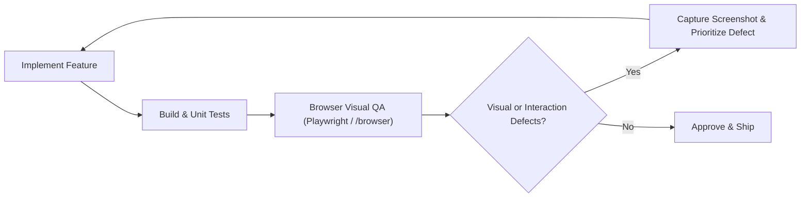

# Browser Visual Verification & Experience QA

A structured multi-stage verification workflow for creative frontend applications, ensuring that implementations are not merely syntactically valid or compiling, but visually stunning, ergonomically correct, and free of defects in a live browser.

---

## 1. The Core Rule

> **Code that compiles is NOT proof that the user experience works.**

Never declare a frontend or visual task complete after simply running `npm build` or unit tests. You must visually inspect the rendered output, check interactive feedback, inspect animation frame rates, and verify responsive viewports.

---

## 2. Multi-Viewport Inspection Matrix

Always verify three canonical viewport sizes:

1. **Desktop Standard**: $1440 \times 900$ (Full layout, multi-column navigation, wide visualizers).
2. **Tablet Portrait / Landscape**: $768 \times 1024$ (Drawer navigation, touch targets $\ge 44\text{px}$, responsive flex wrapping).
3. **Mobile Device**: $390 \times 844$ (Zero horizontal layout overflow, collapsed toolbars, touch-friendly keyboards).

---

## 3. Visual & Interaction Audit Checklist

### Visual Hierarchy & Typography
- [ ] No generic AI template styling (excessive rounded corners, unmotivated floating glassmorphism, or generic gradient text).
- [ ] Text contrast meets WCAG AA (at least 4.5:1 for body copy).
- [ ] Monospace labels are formatted cleanly with tabular numbers (`font-mono tabular-nums`).
- [ ] Light mode and Dark mode transitions are seamless, with no orphaned black/white containers.

### Motion, Scroll & 3D Performance
- [ ] Animations run at a consistent 60 FPS without layout thrashing (`translate3d`, `opacity`, `transform` only).
- [ ] Scroll triggers do not fight user trackpad physics; momentum and inertia feel organic.
- [ ] Canvas / WebGL contexts clean up animation frame handles (`cancelAnimationFrame`) on unmount.
- [ ] Volumetric light beams and additive particle shaders do not cause dropped frames or memory leaks.

### Audio & Interactive Feedback
- [ ] Click feedback is instantaneous ($< 20\text{ms}$).
- [ ] Manual note plucks or chord selections stop prior decaying sound nodes immediately without polyphonic clashing or clipping.
- [ ] Audio clocks use continuous Web Audio scheduling (`AudioContext.currentTime`) rather than drifting `setInterval` loops.

---

## 4. Automated & Agent Verification Tooling

1. **Antigravity Browser Subagent**:
   ```text
   /browser Open http://localhost:5173. Act as a senior design QA engineer.
   1. Check the visual hierarchy and layout.
   2. Verify the piano falling keys visualizer and particle effects.
   3. Test chord switching and playback transitions.
   4. Check for console errors and failed network requests.
   ```

2. **Deterministic Playwright Visual Snapshots**:
   ```bash
   pnpm exec playwright test
   ```
   - Capture full-page screenshots of major views: Landing Stage, Practice Cockpit, Theory Compendium, Guitar Tuner, and Progress Dashboard.
   - Assert zero uncaught JavaScript console errors or network 404/500 errors.

---

## 5. Remediation Feedback Loop



Always iterate until the visual artifact matches the design specification before presenting to the user.
