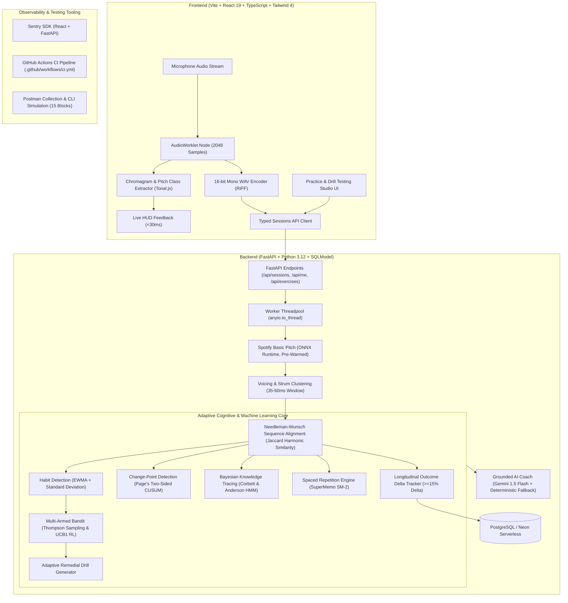

# Adaptive Musical Practice System (Sonus)

An intelligent, production-hardened polyphonic music practice platform for piano and guitar. The system bridges sub-30ms in-browser real-time chromagram feedback with backend neural multipitch transcription, error-tolerant dynamic sequence alignment, statistical motor-habit modeling, Bayesian Knowledge Tracing, SuperMemo SM-2 spaced repetition, Multi-Armed Bandit reinforcement learning, and grounded AI coaching.

---

## 1. Architecture Overview



---

## 2. Scientific Foundations, Cognitive Models & Adaptive Algorithms

### A. Polyphonic Multipitch Neural Transcription
- **Spotify Basic Pitch** ([Bittner et al., ICASSP 2022](https://arxiv.org/abs/2203.09893)):
  - Lightweight, polyphonic multipitch estimation neural network trained on acoustic and synthesized instruments.
  - Generates discrete note events: `[pitch_midi, onset_sec, offset_sec, amplitude]`.
  - Exported to **ONNX Runtime** and pre-warmed during the FastAPI `lifespan` handler to eliminate cold-start latency spikes.
  - Executed off the main event loop via worker threadpools (`anyio.to_thread.run_sync`).

### B. Dynamic Programming Sequence Alignment
- **Needleman-Wunsch / Dynamic Time Warping (DTW)**:
  - Aligns detected chord progressions against exercise templates without cascading misalignment from skipped chords or accidental extra strums.
  - Incorporates a **Jaccard Harmonic Similarity** matrix based on pitch class set overlap ($C_1 \cap C_2 / C_1 \cup C_2$).
  - Computes sub-millisecond onset errors ($\Delta t = t_{\text{detected}} - t_{\text{expected}}$) and voicing completeness percentages.

### C. In-Browser Real-Time Chromagram Engine
- Low-latency AudioWorklet processor capturing 2048-sample audio buffers.
- Applies parabolic FFT peak interpolation across 12 chromatic pitch classes ($C, C\sharp, D, \dots, B$) at 60 FPS ($<30\text{ms}$ total roundtrip latency).
- Music theory parsing powered by mathematical interval algebra and **Tonal.js**.

### D. Statistical Habit Modeling & Change-Point Detection (Component 5)
- **Exponentially Weighted Moving Average (EWMA)** ($\alpha = 0.40$):
  - Prioritizes recent performance repetitions to detect true skill acquisition curves rather than penalizing early warm-up mistakes.
- **Sample Standard Deviation ($\sigma$) & Motor Habit Stability**:
  - Distinguishes erratic motor exploration ($\sigma > 40\text{ms}$) from grooved, mechanical habits ($\sigma < 20\text{ms}$).
- **Page's Two-Sided Cumulative Sum (CUSUM)**:
  - Detects the exact sequential take index where a motor habit crystallizes or breaks down:
    $$S_i^+ = \max(0, S_{i-1}^+ + (x_i - \mu_0 - k))$$
    $$S_i^- = \max(0, S_{i-1}^- - (x_i - \mu_0 + k))$$
  - Triggers an alarm when $S_i^+ > H$ or $S_i^- > H$ ($H = 4\sigma, k = 0.5\sigma$).
- **Bidirectional Drift Modeling**:
  - Distinguishes systematic **Tempo Rushing** (early attacks $\le -25\text{ms}$) from **Tempo Dragging** (falling behind the beat $\ge +30\text{ms}$).
- **Musicological Harmonic Role Weighting**:
  - Dropping chord 3rds/7ths is assigned high severity ($4.0 - 5.0$) because they define harmonic quality (Major vs Minor); dropping roots is high ($3.5$); dropping 5ths is low severity ($2.2$).

### E. Bayesian Knowledge Tracing (BKT)
- Based on the Corbett & Anderson (1995) 2-state Hidden Markov Model.
- Tracks latent student transition mastery $P(L_t)$ per specific chord pair:
  $$P(L_{t-1} \mid \text{Obs}_t = 1) = \frac{P(L_{t-1})(1 - P(S))}{P(L_{t-1})(1 - P(S)) + (1 - P(L_{t-1}))P(G)}$$
  $$P(L_t) = P(L_{t-1} \mid \text{Obs}_t) + (1 - P(L_{t-1} \mid \text{Obs}_t)) \cdot P(T)$$
- Parameters:
  - $P(L_0) = 0.20$ (Prior knowledge)
  - $P(T) = 0.15$ (Transition / learning probability)
  - $P(G) = 0.10$ (Guess probability)
  - $P(S) = 0.10$ (Slip probability)
- Continuous musical takes are mapped into observation likelihoods based on timing jitter ($\le 35\text{ms}$) and voicing completeness ($\ge 85\%$).

### F. Spaced Repetition Engine (SuperMemo SM-2)
- Adapts Wozniak's SM-2 spaced repetition algorithm from discrete flashcards to continuous motor skill acquisition:
  - Maps objective continuous execution metrics ($\Delta t$, voicing completeness) into a standard grade $q \in [0, 5]$.
  - Dynamically updates Ease Factor ($EF \ge 1.3$):
    $$EF' = \max\left(1.3, \; EF + \left(0.1 - (5 - q)(0.08 + (5 - q) \cdot 0.02)\right)\right)$$
  - Calculates inter-repetition review intervals:
    $$I(1) = 1, \quad I(2) = 6, \quad I(n) = \text{round}(I(n-1) \cdot EF)$$

### G. Multi-Armed Bandit Reinforcement Learning
- Uses **Thompson Sampling** (Bayesian conjugate Beta-Binomial posteriors) and **Upper Confidence Bound (UCB1)** to resolve the exploration-exploitation dilemma when selecting pedagogical remedial drill strategies:
  - **Arms / Actions**:
    1. *Rhythmic Strum Isolation* (timing synchronization)
    2. *Anchor Pivot Optimization* (finger biomechanics & transition economy)
    3. *Progressive Multi-Stage Tempo Ramp* (speed ceiling elevation)
    4. *Voicing Reconstruction* (harmonic clarity)
  - **Empirical Reward**: Linked to Longitudinal Outcome Delta Tracking—an arm receives a binary reward $r = 1$ when the student demonstrates a relative improvement $\Delta_{\text{improvement}} \ge 15\%$ (or $>25\text{ms}$ latency reduction) on subsequent takes.
  - **Posterior Sampling**:
    $$\theta_k \sim \text{Beta}(\alpha_k + 1, \; \beta_k + 1), \quad k^* = \arg\max_k \theta_k$$

### H. Grounded AI Coaching Architecture
- Practice feedback is generated via **Google Gemini 1.5 Flash** strictly grounded on pre-computed deterministic mathematical fact bundles (`onset_error_ms`, `voicing_completeness`, `habit_evidence`).
- Zero-failure architecture: If the Gemini API key is absent or rate-limited, the system seamlessly outputs a deterministic pedagogical report without latency spikes or errors.

---

## 3. Technology Stack & Tools

| Layer | Technologies & Tools |
| :--- | :--- |
| **Backend Framework** | Python 3.12, FastAPI, Starlette, Pydantic V2 |
| **Data & ORM** | SQLModel, SQLAlchemy 2.0 (asyncio), PostgreSQL 16+, Neon Serverless, Alembic |
| **Audio & Machine Learning** | Spotify `basic-pitch`, `onnxruntime`, `numpy`, `scipy`, Web Audio API, `AudioWorklet` |
| **Cognitive & Adaptive Engines** | Corbett-Anderson BKT, SuperMemo SM-2, Thompson Sampling / UCB1 Bandit, Page's CUSUM |
| **Frontend Web App** | Vite 8, React 19, TypeScript 5.8, Tailwind CSS 4, Tonal.js, Clerk Auth |
| **Observability & Reliability**| RFC 9457 Problem Details (`application/problem+json`), `X-Request-ID` telemetry, Sentry SDK |
| **Testing & CI/CD** | Pytest (AnyIO), Vitest, Mypy strict, GitHub Actions, Postman Collection & Flows |

---

## 4. API Reference

### Health & Audio
- `GET /health` — Database connection, engine status, and uptime.
- `POST /api/audio/test-transcribe` — Dev endpoint for polyphonic transcription testing.

### User & Analytics (`/api/me`)
- `GET /api/me` — Authenticated profile (Clerk `sub`).
- `POST /api/me` — User onboarding.
- `GET /api/me/sessions` — Practice session history.
- `GET /api/me/stats` — Longitudinal statistics, accuracy, streak, and completed drills.
- `GET /api/me/habits` — Detected habit portfolio (`transition_lag`, `tempo_rushing`, `tempo_dragging`, `voicing_drop`).
- `GET /api/me/interventions` — Active and completed remedial drill assignments.

### Exercises (`/api/exercises`)
- `GET /api/exercises` — Filterable catalog by instrument (`piano`, `guitar`), difficulty, and tags.
- `GET /api/exercises/{id}` — Full progression details, tempo boundaries, and chord structures.
- `POST /api/exercises` — Create custom exercises.

### Practice Sessions & AI Coaching (`/api/sessions`)
- `POST /api/sessions` — Initialize practice session (`exercise_id`, `tempo_bpm`, optional `intervention_id`).
- `GET /api/sessions/{id}` — Session status and scores.
- `POST /api/sessions/{id}/take` — **Core Take Evaluation**: Accepts multipart WAV or JSON chord events. Runs DP alignment, habit detection, outcome tracking, and coaching generation.
- `GET /api/sessions/{id}/analysis` — Per-chord onset error, voicing completeness, and notes breakdown.
- `GET /api/sessions/{id}/coaching` — Grounded pedagogical coaching report.
- `POST /api/sessions/{id}/drill` — Generate tailored adaptive remedial drill with multi-stage tempo ramp.

---

## 5. Testing the System

### A. Interactive Testing Studio (Web UI)
The web application includes a built-in testing studio:
1. Start the dev servers:
   ```bash
   pnpm run dev
   ```
2. Navigate to `http://localhost:5173`.
3. Toggle between:
   - **Practice & Drill Studio**: Select an exercise, start a session, record live audio or submit 1-click pedagogical bottleneck presets ("Transition Lag", "Dragging", "Voicing Drop"), view the chord HUD, read AI coaching feedback, generate remedial drills, and test longitudinal outcome tracking.
   - **Acoustic & FFT Bench**: Live mic input with real-time 12-pitch chromagram visualizer and Spotify Basic Pitch transcription.

### B. Automated Test Suites
```bash
# Run all 72 backend tests (unit, integration, and cognitive adaptive models)
pytest tests/ -v

# Run strict backend static type checking
mypy src/ tests/

# Run frontend Vitest tests
pnpm --filter web test

# Run frontend typecheck and production build
pnpm --filter web build
```

### C. End-to-End Simulation Script
Execute the complete practice loop across all 15 operational blocks:
```bash
python scripts/simulate_practice_flow.py
```

---

## 6. Continuous Integration (CI/CD)

The GitHub Actions pipeline ([`.github/workflows/ci.yml`](.github/workflows/ci.yml)) validates every commit on `main` and `master`:
- **Backend Job**: Sets up Python 3.12, installs dependencies via `uv`, runs `mypy src/ tests/`, and executes `pytest tests/ -v`.
- **Frontend Job**: Sets up Node.js 22, installs packages via `pnpm`, executes `vitest run`, and validates `tsc -b && vite build`.
