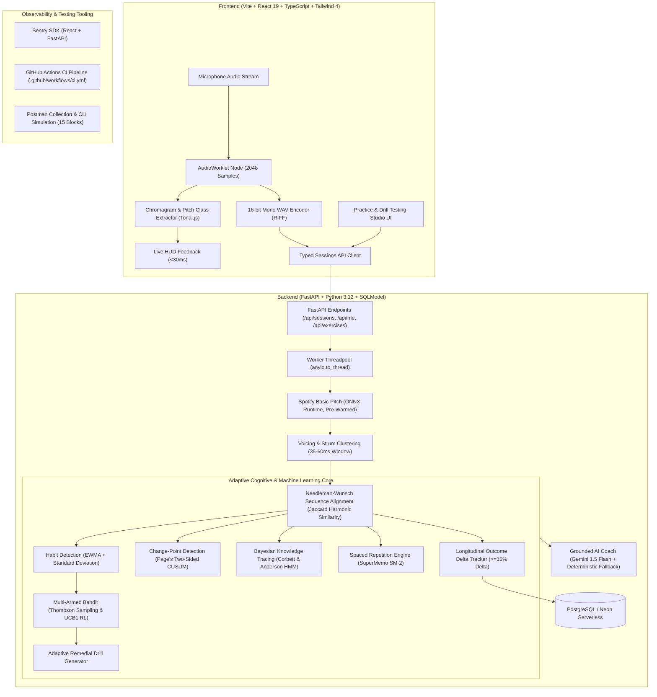

# Adaptive Musical Practice System (Sonus)

An intelligent, production-hardened polyphonic music practice platform for piano and guitar. The system bridges sub-30ms in-browser real-time chromagram feedback with backend neural multipitch transcription, error-tolerant dynamic sequence alignment, statistical motor-habit modeling, Bayesian Knowledge Tracing, SuperMemo SM-2 spaced repetition, Multi-Armed Bandit reinforcement learning, and grounded AI coaching.

---

## 1. Architecture Overview



---

## 2. Scientific Foundations, Cognitive Models & Adaptive Algorithms

### A. Polyphonic Multipitch Neural Transcription
- **Spotify Basic Pitch** ([Bittner et al., ICASSP 2022](https://arxiv.org/abs/2203.09893)):
  - Lightweight, polyphonic multipitch estimation neural network trained on acoustic and synthesized instruments.
  - Generates discrete note events: `[pitch_midi, onset_sec, offset_sec, amplitude]`.
  - Exported to **ONNX Runtime** and pre-warmed during the FastAPI `lifespan` handler to eliminate cold-start latency spikes.
  - Executed off the main event loop via worker threadpools (`anyio.to_thread.run_sync`).

### B. Dynamic Programming Sequence Alignment
- **Needleman-Wunsch / Dynamic Time Warping (DTW)**:
  - Aligns detected chord progressions against exercise templates without cascading misalignment from skipped chords or accidental extra strums.
  - Incorporates a **Jaccard Harmonic Similarity** matrix based on pitch class set overlap ($C_1 \cap C_2 / C_1 \cup C_2$).
  - Computes sub-millisecond onset errors ($\Delta t = t_{\text{detected}} - t_{\text{expected}}$) and voicing completeness percentages.

### C. In-Browser Real-Time Chromagram Engine
- Low-latency AudioWorklet processor capturing 2048-sample audio buffers.
- Applies parabolic FFT peak interpolation across 12 chromatic pitch classes ($C, C\sharp, D, \dots, B$) at 60 FPS ($<30\text{ms}$ total roundtrip latency).
- Music theory parsing powered by mathematical interval algebra and **Tonal.js**.

### D. Statistical Habit Modeling & Change-Point Detection (Component 5)
- **Exponentially Weighted Moving Average (EWMA)** ($\alpha = 0.40$):
  - Prioritizes recent performance repetitions to detect true skill acquisition curves rather than penalizing early warm-up mistakes.
- **Sample Standard Deviation ($\sigma$) & Motor Habit Stability**:
  - Distinguishes erratic motor exploration ($\sigma > 40\text{ms}$) from grooved, mechanical habits ($\sigma < 20\text{ms}$).
- **Page's Two-Sided Cumulative Sum (CUSUM)**:
  - Detects the exact sequential take index where a motor habit crystallizes or breaks down:
    $$S_i^+ = \max(0, S_{i-1}^+ + (x_i - \mu_0 - k))$$
    $$S_i^- = \max(0, S_{i-1}^- - (x_i - \mu_0 + k))$$
  - Triggers an alarm when $S_i^+ > H$ or $S_i^- > H$ ($H = 4\sigma, k = 0.5\sigma$).
- **Bidirectional Drift Modeling**:
  - Distinguishes systematic **Tempo Rushing** (early attacks $\le -25\text{ms}$) from **Tempo Dragging** (falling behind the beat $\ge +30\text{ms}$).
- **Musicological Harmonic Role Weighting**:
  - Dropping chord 3rds/7ths is assigned high severity ($4.0 - 5.0$) because they define harmonic quality (Major vs Minor); dropping roots is high ($3.5$); dropping 5ths is low severity ($2.2$).

### E. Bayesian Knowledge Tracing (BKT)
- Based on the Corbett & Anderson (1995) 2-state Hidden Markov Model.
- Tracks latent student transition mastery $P(L_t)$ per specific chord pair:
  $$P(L_{t-1} \mid \text{Obs}_t = 1) = \frac{P(L_{t-1})(1 - P(S))}{P(L_{t-1})(1 - P(S)) + (1 - P(L_{t-1}))P(G)}$$
  $$P(L_t) = P(L_{t-1} \mid \text{Obs}_t) + (1 - P(L_{t-1} \mid \text{Obs}_t)) \cdot P(T)$$
- Parameters:
  - $P(L_0) = 0.20$ (Prior knowledge)
  - $P(T) = 0.15$ (Transition / learning probability)
  - $P(G) = 0.10$ (Guess probability)
  - $P(S) = 0.10$ (Slip probability)
- Continuous musical takes are mapped into observation likelihoods based on timing jitter ($\le 35\text{ms}$) and voicing completeness ($\ge 85\%$).

### F. Spaced Repetition Engine (SuperMemo SM-2)
- Adapts Wozniak's SM-2 spaced repetition algorithm from discrete flashcards to continuous motor skill acquisition:
  - Maps objective continuous execution metrics ($\Delta t$, voicing completeness) into a standard grade $q \in [0, 5]$.
  - Dynamically updates Ease Factor ($EF \ge 1.3$):
    $$EF' = \max\left(1.3, \; EF + \left(0.1 - (5 - q)(0.08 + (5 - q) \cdot 0.02)\right)\right)$$
  - Calculates inter-repetition review intervals:
    $$I(1) = 1, \quad I(2) = 6, \quad I(n) = \text{round}(I(n-1) \cdot EF)$$

### G. Multi-Armed Bandit Reinforcement Learning
- Uses **Thompson Sampling** (Bayesian conjugate Beta-Binomial posteriors) and **Upper Confidence Bound (UCB1)** to resolve the exploration-exploitation dilemma when selecting pedagogical remedial drill strategies:
  - **Arms / Actions**:
    1. *Rhythmic Strum Isolation* (timing synchronization)
    2. *Anchor Pivot Optimization* (finger biomechanics & transition economy)
    3. *Progressive Multi-Stage Tempo Ramp* (speed ceiling elevation)
    4. *Voicing Reconstruction* (harmonic clarity)
  - **Empirical Reward**: Linked to Longitudinal Outcome Delta Tracking—an arm receives a binary reward $r = 1$ when the student demonstrates a relative improvement $\Delta_{\text{improvement}} \ge 15\%$ (or $>25\text{ms}$ latency reduction) on subsequent takes.
  - **Posterior Sampling**:
    $$\theta_k \sim \text{Beta}(\alpha_k + 1, \; \beta_k + 1), \quad k^* = \arg\max_k \theta_k$$

### H. Grounded AI Coaching Architecture
- Practice feedback is generated via **Google Gemini 1.5 Flash** strictly grounded on pre-computed deterministic mathematical fact bundles (`onset_error_ms`, `voicing_completeness`, `habit_evidence`).
- Zero-failure architecture: If the Gemini API key is absent or rate-limited, the system seamlessly outputs a deterministic pedagogical report without latency spikes or errors.

---

## 3. Technology Stack & Tools

| Layer | Technologies & Tools |
| :--- | :--- |
| **Backend Framework** | Python 3.12, FastAPI, Starlette, Pydantic V2 |
| **Data & ORM** | SQLModel, SQLAlchemy 2.0 (asyncio), PostgreSQL 16+, Neon Serverless, Alembic |
| **Audio & Machine Learning** | Spotify `basic-pitch`, `onnxruntime`, `numpy`, `scipy`, Web Audio API, `AudioWorklet` |
| **Cognitive & Adaptive Engines** | Corbett-Anderson BKT, SuperMemo SM-2, Thompson Sampling / UCB1 Bandit, Page's CUSUM |
| **Frontend Web App** | Vite 8, React 19, TypeScript 5.8, Tailwind CSS 4, Tonal.js, Clerk Auth |
| **Observability & Reliability**| RFC 9457 Problem Details (`application/problem+json`), `X-Request-ID` telemetry, Sentry SDK |
| **Testing & CI/CD** | Pytest (AnyIO), Vitest, Mypy strict, GitHub Actions, Postman Collection & Flows |

---

## 4. API Reference

### Health & Audio
- `GET /health` — Database connection, engine status, and uptime.
- `POST /api/audio/test-transcribe` — Dev endpoint for polyphonic transcription testing.

### User & Analytics (`/api/me`)
- `GET /api/me` — Authenticated profile (Clerk `sub`).
- `POST /api/me` — User onboarding.
- `GET /api/me/sessions` — Practice session history.
- `GET /api/me/stats` — Longitudinal statistics, accuracy, streak, and completed drills.
- `GET /api/me/habits` — Detected habit portfolio (`transition_lag`, `tempo_rushing`, `tempo_dragging`, `voicing_drop`).
- `GET /api/me/interventions` — Active and completed remedial drill assignments.

### Exercises (`/api/exercises`)
- `GET /api/exercises` — Filterable catalog by instrument (`piano`, `guitar`), difficulty, and tags.
- `GET /api/exercises/{id}` — Full progression details, tempo boundaries, and chord structures.
- `POST /api/exercises` — Create custom exercises.

### Practice Sessions & AI Coaching (`/api/sessions`)
- `POST /api/sessions` — Initialize practice session (`exercise_id`, `tempo_bpm`, optional `intervention_id`).
- `GET /api/sessions/{id}` — Session status and scores.
- `POST /api/sessions/{id}/take` — **Core Take Evaluation**: Accepts multipart WAV or JSON chord events. Runs DP alignment, habit detection, outcome tracking, and coaching generation.
- `GET /api/sessions/{id}/analysis` — Per-chord onset error, voicing completeness, and notes breakdown.
- `GET /api/sessions/{id}/coaching` — Grounded pedagogical coaching report.
- `POST /api/sessions/{id}/drill` — Generate tailored adaptive remedial drill with multi-stage tempo ramp.

---

## 5. Running & Testing the System

### A. Interactive Web Application (`apps/web`)
Start the development server using either `pnpm` or `npm`:
```bash
# Start both the FastAPI backend (:8000) and Vite web app (:5173) concurrently
pnpm run dev
# or
npm run dev

# Or start the web frontend standalone (:5173)
pnpm run app:web dev
```

The web application features **Light Mode (Studio Alabaster `#F8F8F6`)** and **Dark Mode (Deep Obsidian `#09090B`)** across four primary views:
1. **Cinematic Landing Stage**: 60fps HTML5 `<canvas>` procedural volumetric smoke and stage lighting, scroll-linked Z-space choreography, interactive repertoire preview, and DSP telemetry cards.
2. **Musician's Practice Room (`PracticeStudioCockpit`)**:
   - **Current Chord → Next Chord Hand Preparation Dock**: Side-by-side Guitar Fretboard or 25-Key Piano Diagrams showing both the active chord and upcoming chord so you can prepare anchor fingers before the beat.
   - **2-Bar Loop & Speed Trainer**: Isolate any hard transition with `70% Slow`, `85% Med`, and `100% Tempo` presets.
   - **1-Click Diagnostic Simulation & Live Mic Evaluation**: Test clean takes or bottleneck presets (*Transition Lag*, *Tempo Dragging*, *Dropped Notes*) and inspect plain-English mistake breakdowns.
3. **Progress, History & Exercise Coach (`ProgressDashboardPage`)**:
   - **Hybrid BKT + SM-2 + Thompson Sampling Prescription Queue**: Ranks what to practice next by combining Bayesian Knowledge Tracing mastery deficit, SuperMemo SM-2 review urgency, and Multi-Armed Bandit posterior sampling ($\theta_k \sim \text{Beta}(\alpha_k, \beta_k)$).
   - **Longitudinal Trajectory & CUSUM Change-Points**: Interactive multi-session chart with Page's Two-Sided CUSUM markers showing where habits formed or clean breakthroughs locked in.
   - **Chord Transition Mastery Matrix**: Per-transition BKT mastery bars, EWMA latency, and SM-2 schedule badges.
4. **Peer Benchmarks & Piece Leaderboards (`PeerComparisonPage`)**:
   - **Interactive Percentile Distribution Bell Curves**: Compare your *Chord Transition Speed (ms)*, *Voicing Completeness (%)*, and *Needleman-Wunsch Score (%)* against global musician percentiles (`P50`, `P75`, `P90`, `P99`).
   - **Filterable Piece Leaderboards**: Repertoire-specific rankings across Piano and Guitar standards with 1-click launch into the Practice Room.

### B. Automated Test Suites
```bash
# Run all backend tests (unit, integration, and cognitive adaptive models)
pytest tests/ -v

# Run strict backend static type checking
mypy src/ tests/

# Run frontend Vitest unit & component tests
pnpm --filter web test
# or
npm run test

# Run frontend typecheck and production build
pnpm --filter web build
# or
npm run build
```

### C. End-to-End Simulation Script
Execute the complete practice loop across all 15 operational blocks:
```bash
python scripts/simulate_practice_flow.py
```

---

## 6. Continuous Integration (CI/CD)

The GitHub Actions pipeline ([`.github/workflows/ci.yml`](.github/workflows/ci.yml)) validates every commit on `main` and `master`:
- **Backend Job**: Sets up Python 3.12, installs dependencies via `uv`, runs `mypy src/ tests/`, and executes `pytest tests/ -v`.
- **Frontend Job**: Sets up Node.js 22 and `pnpm` v10 with `pnpm-lock.yaml` caching, installs workspace packages, executes `pnpm --filter web test` (Vitest), and validates `pnpm --filter web build` (`tsc -b && vite build`).

---

## 7. Academic Citations & Musicological Sources

### A. Machine Learning, Signal Processing & Physical Acoustics
1. **Polyphonic Multipitch Transcription**:
   - Bittner, R. M., Bosch, J. J., Rubinstein, D., Meseguer-Brocal, G., & Ewert, S. (2022). *A Lightweight Instrument-Agnostic Model for Polyphonic Pitch Tracking and Melodic Extraction*. In Proceedings of the IEEE International Conference on Acoustics, Speech and Signal Processing (ICASSP). [arXiv:2203.09893](https://arxiv.org/abs/2203.09893).
2. **Karplus-Strong String Synthesis**:
   - Karplus, K., & Strong, A. (1983). *Digital Synthesis of Plucked-String and Drum Timbres*. Computer Music Journal, 7(2), 43–55. [doi:10.2307/3680062](https://doi.org/10.2307/3680062).
3. **Piano String Inharmonicity Dispersion**:
   - Fletcher, N. H., & Rossing, T. D. (1998). *The Physics of Musical Instruments* (2nd ed.). Springer-Verlag. (Inharmonic overtone stiffness dispersion: f_n = n * f_0 * sqrt(1 + B * n^2)).

### B. Dynamic Programming & Sequence Alignment
1. **Global Sequence Alignment**:
   - Needleman, S. B., & Wunsch, C. D. (1970). *A general method applicable to the search for similarities in the amino acid sequence of two proteins*. Journal of Molecular Biology, 48(3), 443–453. [doi:10.1016/0022-2836(70)90057-4](https://doi.org/10.1016/0022-2836(70)90057-4).
2. **Dynamic Time Warping (DTW)**:
   - Sakoe, H., & Chiba, S. (1978). *Dynamic programming algorithm optimization for spoken word recognition*. IEEE Transactions on Acoustics, Speech, and Signal Processing, 26(1), 43–49.

### C. Cognitive Science, Spaced Repetition & Quality Control
1. **Bayesian Knowledge Tracing (BKT)**:
   - Corbett, A. T., & Anderson, J. R. (1995). *Knowledge tracing: Modeling the acquisition of procedural knowledge*. User Modeling and User-Adapted Interaction, 4(4), 253–278. [doi:10.1007/BF01099821](https://doi.org/10.1007/BF01099821).
2. **Spaced Repetition Memory Consolidation (SuperMemo SM-2)**:
   - Wozniak, P. A. (1990). *Optimization of learning: A new approach to spaced repetition*. Master's thesis, University of Technology in Poznan.
3. **Change-Point Detection (Two-Sided CUSUM)**:
   - Page, E. S. (1954). *Continuous Inspection Schemes*. Biometrika, 41(1/2), 100–115. [doi:10.1093/biomet/41.1-2.100](https://doi.org/10.1093/biomet/41.1-2.100).
4. **Multi-Armed Bandits & Thompson Sampling**:
   - Thompson, W. R. (1933). *On the likelihood that one unknown probability exceeds another in view of the evidence of two samples*. Biometrika, 25(3/4), 285–294.
   - Agrawal, S., & Goyal, N. (2012). *Analysis of Thompson Sampling for the multi-armed bandit problem*. Conference on Learning Theory (COLT), JMLR W&CP 23:39.1–39.26.

### D. Musicological Repertoire & Historical Score Provenance
1. **Pachelbel's Canon Harmonic Flow**:
   - Composer: Johann Pachelbel (1653–1706).
   - Work: *Canon and Gigue in D major for 3 violins and basso continuo* (PWC 37, T. 337, PC 358).
   - Provenance: Urtext edition preserved via the **International Music Score Library Project (IMSLP / Petrucci Music Library)**, Public Domain. Transposed to C Major with 4 authentic contrapuntal variations (Theme Exposition, Counterpoint, Running Polyphony, Grand Cadence).
2. **Waltz No. 2 (Suite for Variety Orchestra)**:
   - Composer: Dmitri Shostakovich (1906–1975).
   - Work: *Suite for Variety Orchestra (Waltz No. 2)* (1956).
   - Provenance: 32-measure authentic melodic line (C5, D5, Eb5, G5) and LH waltz accompaniment (Cm -> Fm -> G7) transcribed for educational keyboard study.
3. **House of the Rising Sun**:
   - Provenance: Traditional English/American folk ballad (Roud Folk Song Index No. 270) in 6/8 compound meter (Am -> C -> D -> F -> Am -> E), standard rolling arpeggiated fingerpicking pattern.
4. **Knockin' Cadence**:
   - Composer: Bob Dylan (1973).
   - Work: *Knockin' on Heaven's Door* (Ram's Horn Music / Columbia Records). Standard 4-chord open-position pedagogical progression (G -> D -> Am -> Am -> G -> D -> C -> C).
