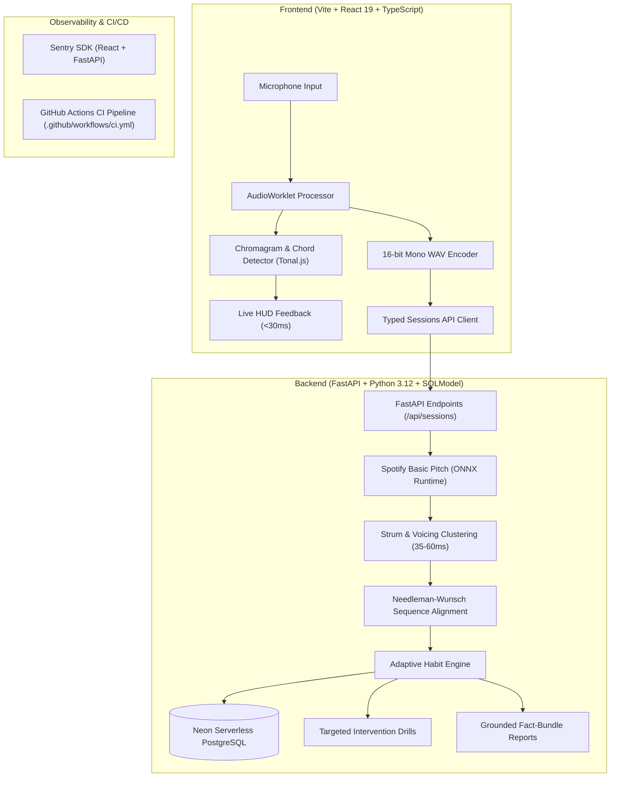

# Adaptive Musical Practice System (Sonus)

An intelligent, open-source polyphonic music practice platform for piano and guitar. The system combines sub-30ms in-browser real-time chromagram feedback with deep backend neural multipitch transcription (Spotify Basic Pitch), error-tolerant sequence alignment, and longitudinal habit tracking to generate targeted adaptive practice drills.

---

## Architecture Overview



---

## Key Features

1. **Hybrid Processing Pipeline**:
   - **Client-Side Real-Time Chromagram**: In-browser `AudioWorklet` captures 2048-sample PCM buffers with zero UI stuttering and projects energy across 12 pitch classes for instant HUD chord detection.
   - **Server-Side Polyphonic Transcription**: Uses Spotify's `basic-pitch` via `onnxruntime` to perform neural multipitch transcription into discrete note events `[pitch, onset, offset, amplitude]`.
2. **Strum & Voicing Clustering**:
   - Differentiates rolling guitar strums (dragged across strings over 30–60ms) from simultaneous piano chord strikes, calculating per-chord voicing completeness and identifying dropped notes.
3. **Error-Tolerant Dynamic Programming Sequence Alignment**:
   - Needleman-Wunsch sequence alignment maps played chord sequences to target exercises, handling accidental extra strums or skipped chords without cascading alignment errors.
4. **Adaptive Habit Engine**:
   - Detects persistent technical habits across sessions:
     - **Transition Lag**: Identifies specific problematic chord changes (e.g., $F \to G > 100\text{ms}$).
     - **Tempo Rushing**: Flags systematic early attacks ($< -30\text{ms}$) on downbeats.
     - **Voicing Drops**: Discovers specific chord tones consistently omitted.
   - Generates actionable remediation drills (isolated transition loops at 75% BPM, subdivision metronome clicks, arpeggios).
5. **Grounded Fact-Bundle Reporting**:
   - Practice summaries are strictly constructed from verified mathematical fact bundles (`fact_id`, `category`, `claim`), eliminating hallucinated feedback.

---

## Repository Layout

| Path | Purpose |
| :--- | :--- |
| `apps/web/` | Vite + React 19 + TypeScript + Clerk authentication |
| `apps/web/src/lib/audio/` | AudioWorklet processor, chromagram chord detector, WAV encoder, metronome |
| `apps/web/src/api/` | Typed API fetch client for practice sessions and exercises |
| `src/lib/audio/` | Polyphonic transcription (Basic Pitch / ONNX), strum clustering, sequence alignment |
| `src/lib/adaptive/` | Habit pattern detectors, intervention generator, grounded fact reporting |
| `src/lib/music/` | Music theory core (chord parsing, pitch classes, Jaccard harmonic similarity) |
| `src/models/` | SQLModel database tables (`Exercise`, `PracticeSession`, `SessionChordMetric`, `HabitPattern`, `AdaptiveIntervention`) |
| `src/services/api/` | FastAPI routers (`/api/exercises`, `/api/sessions`, `/api/me`) |
| `.github/workflows/` | GitHub Actions CI pipeline running tests, typechecks, and production builds |
| `tests/` | Comprehensive backend test suite (34 unit, integration, and E2E tests) |

---

## Tech Stack & Prerequisites

- **Python**: `>=3.12,<3.13` (managed via `uv` or `.venv`)
- **Node.js**: `>=22` and **pnpm**: `>=10.0.0`
- **Database**: PostgreSQL 16+ or **Neon Serverless PostgreSQL**
- **Machine Learning**: Spotify `basic-pitch` powered by `onnxruntime`
- **Observability**: `sentry-sdk` and `@sentry/react`

---

## Quickstart

### 1. Environment Setup

Copy example environment files and populate required credentials:
```bash
cp .env.example.api .env
cp apps/web/.env.example apps/web/.env
```

Ensure your `.env` contains your database connection string and Clerk credentials:
```env
DATABASE_URL=postgresql://<user>:<password>@<neon-host>/neondb?sslmode=require
DATABASE_URL_POOLED=postgresql://<user>:<password>@<neon-pooler-host>/neondb?sslmode=require
CLERK_SECRET_KEY=sk_test_...
```

### 2. Install Dependencies

```bash
# Install frontend packages
pnpm install

# Install backend dependencies in virtual environment
uv pip install -r pyproject.toml
```

### 3. Run Database Migrations

Apply the practice schema migrations to your Neon database:
```bash
pnpm run db:upgrade
```

### 4. Run the Development Server

Start both the FastAPI backend (`:8000`) and the Vite frontend (`:5173`) simultaneously:
```bash
pnpm run dev
```

---

## Running the Automated Test Suites

### Backend Tests (Python)
```bash
# Run all 34 unit, integration, and end-to-end tests
pytest tests/ -v

# Run strict Mypy static type checking
mypy src/ tests/
```

### Frontend Tests (TypeScript & Vitest)
```bash
# Run Vitest unit tests (chord detector, WAV encoder, API client)
pnpm --filter web test

# Run TypeScript type check and production bundle
pnpm --filter web build
```

---

## Continuous Integration (CI/CD)

Every push to `master` or `main` automatically triggers the GitHub Actions CI pipeline in [`.github/workflows/ci.yml`](.github/workflows/ci.yml):
- **Backend Job**: Sets up Python 3.12, installs dependencies with `uv`, runs `mypy src/ tests/`, and executes `pytest tests/ -v`.
- **Frontend Job**: Sets up Node.js 22, installs dependencies via `pnpm`, executes `vitest run`, and verifies `tsc -b && vite build`.
