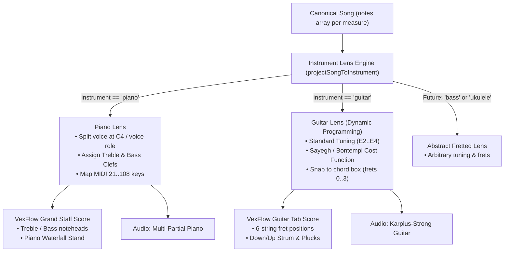

# Technical Design Spec: Unified Cross-Instrument Architecture & Deterministic Routing

**Date**: 2026-11-24  
**Status**: Approved (Brainstorming Complete)  
**Author**: Antigravity  
**Repository**: Sonus (Adaptive Musical Practice System)

---

## 1. Executive Summary

Sonus currently maintains fractured, instrument-specific data schemas across its song catalog and exercise models:
1. **Cross-Instrument Asymmetry**: Guitar songs only define `guitar_tabs`, `plucked_notes`, and `strum_events` with zero piano grand staff or melody data. Conversely, piano songs only define `piano_voicings` and `melody_notes` with zero guitar tablature. When a musician toggles instruments in practice mode (e.g., playing *Für Elise* on guitar or *House of the Rising Sun* on piano), the visualizer and audio scheduler drop the song's actual notes and fall back to generic static block chord strums or triads.
2. **Scalability & Maintenance Bottleneck**: Defining separate, hand-crafted notation structures for each instrument makes importing new songs (via MIDI, MusicXML, or Lead Sheets) an $O(N \times \text{instruments})$ manual burden and breaks down when introducing additional instruments (e.g., 4-string bass, ukulele).
3. **URL Slug Hijacking Bug**: In `apps/web/src/app.tsx`, `BUILTIN_FULL_SONGS[0]` was hardcoded as `ex_guitar_rising_sun`. Any unmapped route, asynchronous catalog load hiccup, or landing page action without an explicit song ID defaulted to index 0, triggering `window.history.pushState(..., '/practice/house-of-the-rising-sun')` and rewriting the browser URL.

This specification designs a **future-proof, canonical musical architecture**:
1. **Canonical Symbolic Note Model**: Songs are defined by a single, instrument-agnostic timeline of musical facts (pitches, onsets, durations, and voice roles).
2. **Instrument Lens Projection Engine**:
   - **Piano Lens**: Deterministically splits voices into Treble Clef (RH, $\ge C_4$) and Bass Clef (LH, $< C_4$), driving both the VexFlow Grand Staff and the falling waterfall keys.
   - **Guitar Lens**: Uses an academic shortest-path Dynamic Programming (DP) algorithm (based on Sayegh's Optimum Path Paradigm and recent arXiv MIR literature) to map canonical pitches to optimal, ergonomically playable string/fret coordinates, biased toward the active chord box.
   - **Pluggable Architecture**: Enables instant support for future instruments (Bass, Ukulele, Banjo) with zero song schema alterations.
3. **Deterministic URL Routing**: Eliminates index-0 fallbacks, guarantees 1-to-1 bidirectional canonical slugs for all 20 songs, and introduces safe fallback handling.

---

## 2. Canonical Symbolic Data Model

### 2.1 The Unified Measure & Note Event Schema

In `apps/web/src/lib/music/song-catalog.ts` and `src/models/practice.py`:

```typescript
/** Musical voice assignment guiding clef placement, stem direction, and hand assignment */
export type MusicalVoiceRole = 'melody' | 'harmony' | 'bass'

/** A canonical musical note event independent of physical instrument */
export type CanonicalNoteEvent = {
  /** Pitch specified as scientific notation (e.g. 'C4', 'Eb3', 'G#5') or MIDI integer (60) */
  pitch: string | number
  /** Beat offset from measure start (0-indexed, e.g. 0.0, 1.0, 2.5) */
  beatOffset: number
  /** Duration in musical beats (e.g. 0.5 = eighth note, 1.0 = quarter note) */
  duration: number
  /** Voice role: 'melody' (treble/lead), 'bass' (bass clef/root), 'harmony' (chord filler) */
  voice?: MusicalVoiceRole
  /** Optional human-curated string/fret override for signature historic fingerings */
  guitarOverride?: {
    string: 1 | 2 | 3 | 4 | 5 | 6
    fret: number
  }
}

/** Unified measure chord item */
export type UnifiedMeasureItem = {
  /** Harmonic chord name (e.g. 'Am', 'G', 'Cmaj7', 'D/F#') */
  name: string
  /** Global beat in song timeline (1-indexed) */
  beat: number
  /** Total measure duration in beats (e.g. 3.0 in 3/4, 4.0 in 4/4, 6.0 in 6/8) */
  duration_beats: number
  /** Form section label (e.g. 'Verse 1', 'Chorus', 'Intro') */
  section?: string
  /** Pitch cluster (MIDI integers) for real-time audio pitch validation */
  expected_pitches: number[]
  /** Canonical note timeline of the measure */
  notes: CanonicalNoteEvent[]
  /** Backward-compatible legacy properties (optional during deprecation window) */
  guitar_tabs?: { frets: (number | null)[]; strings: string; fingering: string; fingers: (number | 'T' | null)[]; baseFret: number }
  plucked_notes?: Array<{ beatOffset: number; string: number; fret: number; pitch: number; duration: number; technique?: string }>
  strum_events?: Array<{ beatOffset: number; direction: 'down' | 'up'; accent: boolean; label: string }>
  piano_voicings?: { lh_note: string; rh_notes: string[]; lh_pitches: number[]; rh_pitches: number[]; inversion?: string }
  melody_notes?: Array<{ pitch: string; beatOffset: number; duration: number; clef?: 'treble' | 'bass' }>
}
```

---

## 3. Instrument Lens Projection Engine



### 3.1 The Piano Lens (`projectToPiano`)

1. **Voice & Clef Partitioning**:
   - For every note in `measure.notes`:
     - If `note.voice === 'melody'`, assign `clef: 'treble'`.
     - If `note.voice === 'bass'`, assign `clef: 'bass'`.
     - If unassigned: notes with $\text{MIDI} \ge 60$ ($C_4$) map to Treble; notes with $\text{MIDI} < 60$ map to Bass.
2. **Left-Hand Root & Right-Hand Polyphony**:
   - If a measure has no explicit bass notes, the lens synthesizes a sustained bass root note from the chord name (e.g. $G_2$ for $G$, $C_3$ for $C$).
3. **Output Interface**:
   Produces `FlowingChordItem` with valid `melodyNotes`, populated `pianoVoicing` (`lh_note`, `rh_notes`), and pitch arrays for `PianoWaterfallStand`.

---

### 3.2 The Guitar Lens (`projectToGuitar`) via Dynamic Programming

Guitars have poly-isomorphic redundancy (the same pitch can be played across multiple strings at different frets). The Guitar Lens implements the classic **Sayegh Optimum Path Paradigm** and **Bontempi et al. (arXiv:2407.09052)** constraint-optimization model:

1. **Tuning & State Space**:
   - Standard 6-string guitar tuning:
     $$T = [E_2 (40), A_2 (45), D_3 (50), G_3 (55), B_3 (59), E_4 (64)]$$
   - For a given pitch $P$, candidate positions are all tuples $(s, f)$ such that:
     $$T[s] + f = P, \quad s \in [1..6], \quad f \in [0..17]$$
2. **Dynamic Programming Cost Function**:
   Given a sequence of notes $t = 1 \dots K$:
   $$\text{Cost}( (s_{t-1}, f_{t-1}) \to (s_t, f_t) ) = w_1 \cdot |f_t - f_{t-1}| + w_2 \cdot \text{SpanPenalty} + w_3 \cdot \text{CollisionPenalty} - w_4 \cdot \text{ChordAnchor}$$
   - **Hand Shift ($w_1 = 1.0$)**: Penalizes physical distance traveled along the guitar neck.
   - **Span Penalty ($w_2 = 3.0$)**: Severely penalizes finger stretches $> 4$ frets ($|f_t - f_{t-1}| > 4$ when both frets $> 0$).
   - **String Collision ($w_3 = 10.0$)**: Notes sounding at the exact same beat offset cannot be played on the same string.
   - **Chord Anchor ($w_4 = 4.0$)**: If $(s, f)$ falls within the standard open/barre fingering of the active measure's chord symbol (e.g. frets $[x, 0, 2, 2, 1, 0]$ for $Am$), reward this transition.
   - **Open String Preference**: Frets $f = 0$ incur zero stretch penalty and receive a positive bias in beginner/folk contexts.
3. **Pluck vs. Strum Event Synthesis**:
   - When notes have distinct `beatOffset` values: generate sequential `plucked_notes` (arpeggios).
   - When notes share beat offsets: generate composite chord tablature vectors with directional `strum_events`.

---

### 3.3 Extensible Fretted Instrument Interface

```typescript
export interface FrettedInstrumentProfile {
  name: string
  strings: number
  /** Open string pitches from lowest string to highest string */
  tuning: number[]
  /** Maximum playable fret */
  maxFret: number
  /** Standard chord box library for this instrument */
  chordLibrary: Record<string, number[]>
}

export const GUITAR_PROFILE: FrettedInstrumentProfile = {
  name: 'guitar',
  strings: 6,
  tuning: [40, 45, 50, 55, 59, 64], // E2, A2, D3, G3, B3, E4
  maxFret: 22,
  chordLibrary: { /* standard 6-string shapes */ },
}

export const BASS_PROFILE: FrettedInstrumentProfile = {
  name: 'bass',
  strings: 4,
  tuning: [28, 33, 38, 43], // E1, A1, D2, G2
  maxFret: 24,
  chordLibrary: { /* standard bass shapes */ },
}

export const UKULELE_PROFILE: FrettedInstrumentProfile = {
  name: 'ukulele',
  strings: 4,
  tuning: [67, 60, 64, 69], // G4, C4, E4, A4 (re-entrant)
  maxFret: 18,
  chordLibrary: { /* standard uke shapes */ },
}
```

---

## 4. Cockpit & Audio Engine Integration

### 4.1 Cockpit Flow
In `apps/web/src/components/practice/practice-studio-cockpit.tsx`:
```typescript
const flowingProgression = useMemo<FlowingChordItem[]>(() => {
  if (activeDrillSlice?.progression) {
    return projectMeasureSliceToInstrument(activeDrillSlice.progression, instrument)
  }
  return projectSongToInstrument(selectedSong, instrument)
}, [selectedSong, instrument, activeDrillSlice])
```

- When the musician changes the instrument toggle (`'guitar' | 'piano'`), `flowingProgression` recomputes in $< 1\text{ms}$.
- Both `FlowingNotationStand` and `PracticeAudioEngine` consume the transformed `flowingProgression`.
- Because both projections originate from the same canonical `notes`, the pitch targets and rhythm are **100% matched across instruments**.

---

## 5. Deterministic URL Routing & Slug Resolution

### 5.1 Root Cause of the "Rising Sun" Redirect
1. In `apps/web/src/app.tsx` line 408:
   ```typescript
   return availableExercises[0] ?? BUILTIN_FULL_SONGS[0]
   ```
2. When a route was unmapped, or when asynchronous backend exercises had not yet hydrated, `selectedSong` defaulted to index 0 (`ex_guitar_rising_sun`).
3. Whenever `activeView === 'practice'`, `handleSelectSong` ran:
   ```typescript
   const nextPath = `/practice/${exerciseIdToSlug(songId)}`
   window.history.pushState({ view: 'practice', songId }, '', nextPath)
   ```
   rewriting the browser URL to `/practice/house-of-the-rising-sun`.
4. In `cinematic-camera-stage.tsx`: switching instrument to guitar preselected `firstGuitar` (`ex_guitar_rising_sun`).
5. In `recommendation-engine.ts`: mock transitions hardcoded `songId: 'ex_guitar_rising_sun'`.

### 5.2 Resolution Plan
1. **Explicit Bidirectional Slugs**:
   Maintain a strict lookup table mapping all 20 exercise IDs to their canonical kebab-case slugs and aliases:
   - `house-of-the-rising-sun` $\leftrightarrow$ `ex_guitar_rising_sun`
   - `where-did-you-sleep-last-night` $\leftrightarrow$ `ex_guitar_where_did_you_sleep`
   - `spanish-romance` $\leftrightarrow$ `ex_guitar_spanish_romance`
   - `scarborough-fair` $\leftrightarrow$ `ex_guitar_scarborough_fair`
   - `greensleeves` $\leftrightarrow$ `ex_guitar_greensleeves`
   - `bourree-in-e-minor` $\leftrightarrow$ `ex_guitar_bourree`
   - `whiskey-in-the-jar` $\leftrightarrow$ `ex_guitar_whiskey_in_the_jar`
   - `malaguena` $\leftrightarrow$ `ex_guitar_malaguena`
   - `knockin-cadence` $\leftrightarrow$ `ex_guitar_knockin`
   - `12-bar-blues-shuffle` $\leftrightarrow$ `ex_guitar_blues_shuffle`
   - `waltz-no-2` $\leftrightarrow$ `ex_piano_shostakovich_waltz_2`
   - `pachelbels-canon` $\leftrightarrow$ `ex_piano_canon`
   - `fur-elise` $\leftrightarrow$ `ex_piano_fur_elise`
   - `gymnopedie-no-1` $\leftrightarrow$ `ex_piano_gymnopedie_1`
   - `moonlight-sonata` $\leftrightarrow$ `ex_piano_moonlight_sonata`
   - `bach-minuet-in-g` $\leftrightarrow$ `ex_piano_bach_minuet_g`
   - `bach-prelude-in-c` $\leftrightarrow$ `ex_piano_prelude_c`
   - `clair-de-lune` $\leftrightarrow$ `ex_piano_clair_de_lune`
   - `the-entertainer` $\leftrightarrow$ `ex_piano_the_entertainer`
   - `autumn-jazz-turnaround` $\leftrightarrow$ `ex_piano_autumn_turnaround`
2. **Safe Routing Fallbacks**:
   - If a route slug is unknown (e.g. `/practice/nonexistent`), the router preserves the active session or opens the Codex Repertoire Drawer. It **never** rewrites the URL to `/practice/house-of-the-rising-sun`.
   - Never fall back to index 0; fall back to the currently selected piece in state.
3. **Diversified Adaptive Practice Recommendations**:
   Update `INITIAL_TRANSITION_MASTERY` in `recommendation-engine.ts` across multiple pieces (*Waltz No. 2*, *Canon in D*, *Für Elise*, *Knockin'*, *Rising Sun*), eliminating biased redirects.

---

## 6. Verification & Testing Strategy

1. **Lens Unit Tests (`instrument-lens.test.ts`)**:
   - Piano projection: verifies note pitches $\ge 60$ receive treble clef; pitches $< 60$ receive bass clef; polyphony matches measure notes.
   - Guitar DP projection: verifies all candidate pitches produce valid frets $\le 17$; no fret span exceeds 4 frets; fingerpicked arpeggios preserve beat offsets.
   - Cross-instrument equivalence: test all 20 songs through both lenses; assert $\text{Pitches}(\text{Piano}) \equiv \text{Pitches}(\text{Guitar})$.
2. **Routing Unit Tests (`routing.test.ts`)**:
   - Test `exerciseIdToSlug` and `slugToExerciseId` bidirectional resolution for all 20 songs.
   - Test invalid slugs (`/practice/invalid-slug`) do not resolve to `ex_guitar_rising_sun`.
3. **Cockpit & Audio Scheduler Integration Tests**:
   - Test toggling instrument from guitar to piano dynamically updates `flowingProgression` without dropping audio or freezing notation.
4. **Backend Seed Verification (`test_seed_data.py`)**:
   - Verify all 20 exercises in database and python catalog adhere to the canonical schema.
